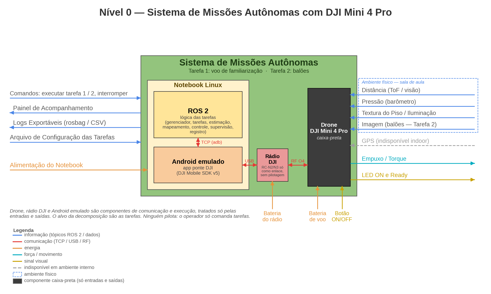
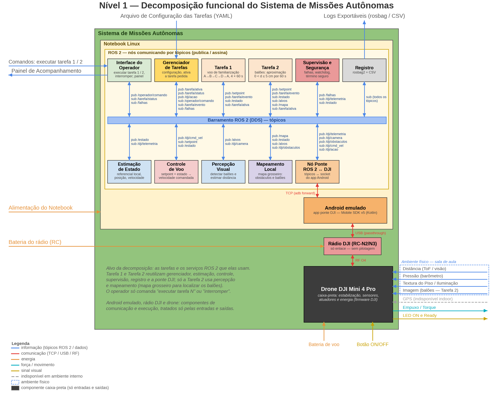
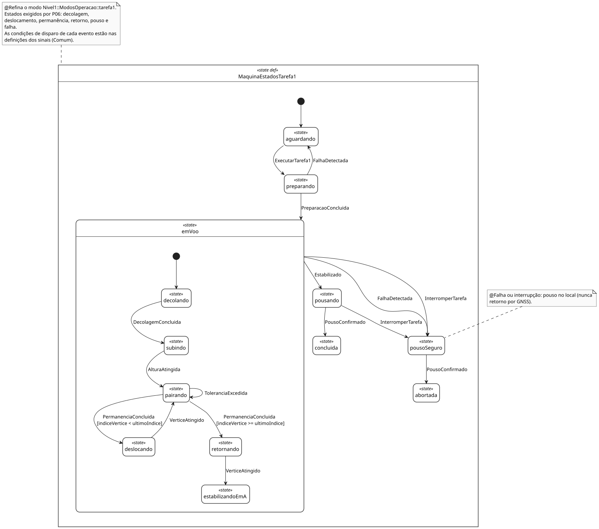

# PSI3442 — Segunda Prova — Entrega intermediária

**Sistema de Missões Autônomas com DJI Mini 4 Pro**
Arquitetura, modelo SysML 2.0, requisitos, interfaces, hipóteses, critérios de aceitação e planos de implementação e de testes.

| Integrante | Número USP |
|---|---|
| Caetano Maciel Anibali | 13681130 |

Entrega: 27/11/2026 · Repositório: <https://github.com/Caetano-ma/PSI-3442> · Versão do modelo: commit indicado na capa do pacote enviado.

---

## 1. Visão geral da solução

O drone é um produto comercial dado; o problema é de **software**. A solução é um **Sistema de Missões Autônomas**
em que o operador só envia três comandos — `executar tarefa 1`, `executar tarefa 2` e `interromper` — e o sistema
realiza a tarefa pedida de forma autônoma até o pouso:

- **Tarefa 1** — voo de familiarização (Questão 1): quadrado A-B-C-D de 1,50 m a 1,80 m, quatro permanências de 60 s,
  retorno e pouso suave.
- **Tarefa 2** — balões (Questão 2): busca, aproximação a 0 < d ≤ 5 cm por 60 s, próximo alvo.

Componentes (método sistêmico: o alvo da decomposição são as tarefas; drone e rádio são caixas-pretas):

| Componente | Papel |
|---|---|
| Notebook Linux (Ubuntu 24.04 / Mint 22) com **ROS 2 Jazzy** | Toda a lógica das tarefas em nós ROS 2 (Python, rclpy). |
| **Android emulado** no mesmo notebook | Executa o *app ponte* (Kotlin) com o **DJI Mobile SDK v5**; fala com o ROS 2 por TCP. |
| **Rádio DJI (RC-N2 ou RC-N3)** | Enlace exigido pelo SDK (caminho da seção 6 do enunciado); **não é usado para pilotar**. |
| **DJI Mini 4 Pro** | Caixa-preta: estabilização, sensores, atuadores e energia ficam no firmware DJI. |

Caminho de comunicação: nós ROS 2 ↔ TCP (adb forward) ↔ app ponte (Android emulado) ↔ USB ↔ rádio RC-N2/RC-N3 ↔ enlace
O4 ↔ aeronave. Nenhum código é instalado no controlador de voo.

## 2. Modelo SysML 2.0

- **Ambiente** (compatível, conforme seção 4): *SysML v2 Pilot Implementation* 0.63.1 (OMG/Systems Modeling), kernel
  Jupyter, com JupyterLab 4. Os arquivos são texto SysML 2.0 padrão e podem ser importados em ferramentas compatíveis.
- **Arquivos editáveis** (`modelo_sysml/`): `00_Comum.sysml` (tipos, tópicos, requisitos), `01_Nivel0.sysml`,
  `02_Nivel1.sysml`, `03_NivelN.sysml`, `04_Verificacao.sysml`.
- **Validação reprodutível:** `python executar_modelo.py` executa o modelo no kernel, aponta erros e exporta 14 vistas
  (`modelo_sysml/vistas/`); `python3 gerar_matriz.py` gera a matriz de rastreabilidade e confere a consistência entre
  níveis. Estado atual: modelo sem erros; matriz da Tarefa 1 sem pendências.

### 2.1 Nível 0 — sistema de interesse

- **Função global:** ao receber `executar tarefa N`, realizar a tarefa N de forma autônoma até o pouso, respeitando
  tolerâncias e restrições, registrando evidências e interrompendo com segurança quando comandado.
- **Atores e elementos externos:** operador, ambiente físico (sala), fonte de energia, arquivo de configuração (YAML),
  repositório de logs, GNSS (indisponível — não usado), simulador (opcional, ambiente de teste).
- **Entradas e saídas:** comandos e painel do operador; configuração; logs (rosbag2/CSV); grandezas sensoriadas pela
  aeronave (distância, pressão, textura/iluminação, imagem); empuxo; LEDs; energia de notebook, rádio e aeronave.
- **Cenário de operação** (`Nivel0::CenarioOperacao`): preparar o ambiente → posicionar a aeronave em A com o nariz
  para B → ligar aeronave, rádio e notebook → carregar a configuração → `executar tarefa 1` → execução autônoma →
  exportar evidências.
- **Diferenças em relação aos modelos anteriores** (P1, outro drone): GPS rebaixado a entrada indisponível; textura do
  piso e iluminação passam a ser entrada; botão Reset removido (inexistente no Mini 4 Pro); estação de solo substituída
  por notebook com ROS 2 e Android emulado; controle remoto rebaixado a rádio; drone deixa de ser decomposto
  internamente.

### 2.2 Nível 1 — decomposição funcional

Onze nós ROS 2, ligados por tópicos (publica/assina), mais os componentes caixa-preta:

| Nó ROS 2 | Função (nível 1) | Tarefas |
|---|---|---|
| Interface do Operador | interpretar comando, painel | 1 e 2 |
| Gerenciador de Tarefas | carregar configuração, ativar a tarefa, modos globais, decolar/pousar | 1 e 2 |
| Tarefa 1 | conduzir o voo de familiarização | 1 |
| Tarefa 2 | conduzir a busca e aproximação aos balões | 2 |
| Estimação de Estado | estado no referencial local | 1 e 2 |
| Controle de Voo | setpoint + estado → velocidade comandada | 1 e 2 |
| Supervisão e Segurança | detectar falhas, término seguro | 1 e 2 |
| Registro | rosbag2 + exportação CSV | 1 e 2 |
| Nó Ponte ROS 2 ↔ DJI | traduzir tópicos ↔ socket do app ponte | 1 e 2 |
| Percepção Visual | detectar e classificar balões, distância | 2 |
| Mapeamento Local | mapa grosseiro: obstáculos e posição relativa dos balões | 2 |

**Reuso entre as tarefas:** gerenciador, estimação, controle, supervisão, registro e ponte são comuns; só a Tarefa 2
acrescenta percepção e mapeamento. A Tarefa 1 usa, portanto, a mesma arquitetura de comando, supervisão e registro
que a Tarefa 2, como exige a Questão 1.

**Modos de operação** (`Nivel1::ModosOperacao`): ocioso → (`executar tarefa 1`) tarefa1 / (`executar tarefa 2`) tarefa2
→ ocioso ao concluir; falha ou `interromper` → término seguro (pouso no local, nunca retorno por GNSS) → ocioso.
A Tarefa 2 só é aceita depois de a Tarefa 1 ter sido concluída em voo real (critério de progressão).

### 2.3 Proposta de nível n

Detalhado até módulos implementáveis para a Tarefa 1, os serviços comuns e a ponte (`03_NivelN.sysml`); Tarefa 2,
percepção e mapeamento serão detalhados no próximo ciclo.

- **Critério de profundidade:** cada folha (i) é um único arquivo/classe, (ii) tem entradas e saídas tipadas com
  unidades e referencial definidos e (iii) é verificável isoladamente (teste unitário ou ensaio). Drone e rádio param no
  próprio componente: abaixo dele nada é observável nem alterável; são explorados só pela interface do SDK.
- **Módulos (arquivo previsto):** app ponte — `ConexaoSdk.kt`, `LeitorTelemetria.kt`, `EmissorComandos.kt`
  (conversão de referencial e watchdog), `ConfiguradorSeguranca.kt`, `ServidorSocket.kt`; ROS 2 —
  `no_interface_operador.py`, `painel.py`, `carregador_config.py`, `no_gerenciador_tarefas.py`,
  `planejador_trajetoria.py`, `verificador_tolerancia.py`, `cronometro_permanencia.py`, `no_tarefa1.py`,
  `no_estimacao_estado.py`, `no_controle_voo.py`, `no_supervisao.py`, `cliente_socket_ponte.py`, `no_ponte_dji.py`,
  `launch/registro.launch.py`, `ferramentas/exportar_csv.py`.
- **Algoritmos:** estimação por integração trapezoidal das velocidades do posicionamento visual da DJI (o SDK não
  fornece posição em ambiente interno), altura pelo sensor ToF; controle proporcional por eixo com saturação
  (kp = 0,8 s⁻¹ inicial, |v| ≤ 0,3 m/s); cronômetro em relógio monotônico, zerado ao sair da tolerância.
- **Referencial local:** origem no ponto de decolagem no piso; x de A para B (nariz na decolagem, guinada ψ₀); y de A
  para D; z para cima. x = N cos ψ₀ + E sin ψ₀; y = N sin ψ₀ − E cos ψ₀; v_z = −v_baixo.
- **Taxas e temporizações:** telemetria 10 Hz; cadeia de controle 10 Hz; envio ao SDK 20 Hz; watchdog do app ponte
  0,2 s; perda da ponte 2 s; amostra considerada velha após 0,3 s (estimação) e 0,5 s (supervisão).
- **Máquina de estados da Tarefa 1** (exigência de P06):

## 3. Requisitos

| Id | Requisito (resumo) | Tarefa |
|---|---|---|
| P01 | Decolar até 1,80 m do piso (ponto de referência: plano inferior do corpo da aeronave) | 1 |
| P02 | Quadrado de 1,50 m a 1,80 m; vértices A(0;0;1,80) B(1,50;0;1,80) C(1,50;1,50;1,80) D(0;1,50;1,80) | 1 |
| P03 | 60 s contínuos em A, B, C e D, nessa ordem (ou inversa); sem segunda espera em A | 1 |
| P04 | Retornar a A e pousar suavemente; pouso confirmado por telemetria | 1 |
| P05 | Tolerâncias e limites declarados antes dos testes; contagem reinicia ao excedê-los | 1 |
| P06 | Modelo SysML (0, 1, n), implementação, configuração, logs e evidências em voo real | 1 |
| R01–R06, R08, R09 | Configuração, percepção, autonomia, 5 cm por 60 s, estimação, restrições, observabilidade, reprodutibilidade | 2 |
| R07 | Falhas tratadas com término seguro em sala; GNSS não é solução válida | 1 e 2 |

Todos estão no modelo (`Comum::RequisitosQ1`, `Comum::RequisitosQ2`), satisfeitos pelo sistema no nível 0 e ligados às
funções do nível 1.

## 4. Critérios quantitativos de aceitação da Tarefa 1 (P05) — para aprovação

| Grandeza | Valor proposto | Justificativa |
|---|---|---|
| Tolerância vertical | ±0,10 m | Precisão de voo pairado vertical especificada pela DJI com posicionamento visual (±0,1 m, a confirmar no manual): exigir menos que a plataforma entrega não é verificável. |
| Tolerância horizontal | ±0,30 m | Precisão horizontal especificada pela DJI com posicionamento visual (±0,3 m, a confirmar). Equivale a 20 % da aresta: os círculos de tolerância de vértices vizinhos (1,50 m) não se sobrepõem. |
| Velocidade máxima para "pairado" | 0,15 m/s | Metade da velocidade de deslocamento (0,30 m/s): separa pairar de deslocar; mantida por 2 s, desloca no máximo a tolerância horizontal. |
| Velocidade vertical máxima no toque | 0,50 m/s | Equivale a uma queda livre de ≈1,3 cm (v²/2g): toque suave. Descida controlada a ≤ 0,3 m/s até 0,30 m do piso e pouso automático da DJI. |
| Permanência | ≥ 60 s contínuos | Enunciado; relógio monotônico do notebook, resolução 0,1 s (amostras a 10 Hz); qualquer amostra fora da tolerância zera a contagem. |
| Posição de pouso | ≤ 0,30 m de A | Mesma tolerância horizontal. |
| Altura (P01) | ∣z − 1,80∣ ≤ 0,10 m | Mesma tolerância vertical, medida no ponto de referência declarado. |

Grandezas registradas ao longo do tempo (P05): posição e velocidade estimadas, veredito de tolerância, tempo de
permanência, comandos enviados, bateria e eventos (CSV a 10 Hz). Erros reportados (seção 7 do enunciado): altura,
trajetória, fechamento do quadrado, tempos de permanência e velocidade vertical no toque. Outros parâmetros de
segurança: bateria mínima 30 %, tempo máximo da tarefa 600 s, desvio máximo antes de abortar 0,60 m.

## 5. Interfaces

### 5.1 Tópicos ROS 2

| Tópico | Mensagem | Publica | Assina | Taxa / QoS |
|---|---|---|---|---|
| `/operador/comando` | ComandoOperador | Interface | Gerenciador | sob demanda / reliable |
| `/tarefa/ativa` | TarefaAtiva | Gerenciador | Tarefa 1, Tarefa 2 | sob demanda / reliable, transient local |
| `/tarefa/status` | StatusTarefa | Gerenciador | Interface, Registro | 2 Hz / reliable |
| `/tarefa/evento` | EventoTarefa | Tarefa 1, Tarefa 2 | Gerenciador, Registro | sob demanda / reliable |
| `/dji/acao` | ComandoDiscreto | Gerenciador | Ponte | sob demanda / reliable |
| `/setpoint` | Setpoint | Tarefa 1, Tarefa 2 | Controle | 10 Hz / best effort |
| `/estado` | EstadoEstimado | Estimação | Tarefas, Controle, Supervisão, Mapeamento, Registro | 10 Hz / best effort |
| `/dji/telemetria` | Telemetria | Ponte | Estimação, Supervisão | 10 Hz / best effort |
| `/dji/cmd_vel` | ComandoVelocidade | Controle | Ponte | 10 Hz / best effort, profundidade 1 |
| `/falhas` | Falha | Supervisão | Gerenciador, Interface, Registro | sob demanda / reliable |
| `/dji/camera`, `/dji/obstaculos`, `/alvos`, `/mapa` | quadro, distâncias, detecções, mapa | Ponte, Percepção, Mapeamento | Percepção, Mapeamento, Tarefa 2 | Tarefa 2 |

Mensagens próprias no pacote `psi3442_interfaces`; unidades SI em todas as mensagens.

### 5.2 Socket nó ponte ↔ app ponte

TCP na porta 5760 via `adb forward`; mensagens JSON, uma por linha, com campo `tipo` (`telemetria`, `cmd_vel`, `acao`,
`heartbeat`, `erro`). Telemetria a 10 Hz; comandos a 20 Hz; heartbeat a 1 Hz nos dois sentidos. Sem comando por 0,2 s,
o app envia velocidade zero; sem heartbeat por 2 s, o app comanda pouso automático.

### 5.3 SDK (caixa-preta) — recursos explorados (nomes a confirmar na versão do SDK)

Compatibilidade (notas de versão do DJI Mobile SDK v5): o Mini 4 Pro é suportado a partir da versão 5.13.0 (atual:
5.20.1), somente com os controles DJI RC N2 e DJI RC N3; o DJI RC 2 não consta, e a conexão direta celular ↔ aeronave
sem controle não é documentada para este modelo. O controle é, portanto, indispensável como rádio, mesmo sem
pilotagem.

Leitura: velocidade norte/leste/baixo, altitude relativa, altura ToF, guinada, em voo, motores ligados, modo de voo,
bateria, conexão, posicionamento visual ativo, distâncias de obstáculos (Tarefa 2), vídeo (Tarefa 2). Comando:
decolagem e pouso automáticos, controle virtual em velocidade (referencial do solo), ação em perda de sinal = pousar.

## 6. Hipóteses

| Id | Hipótese | Como será tratada |
|---|---|---|
| H1 | Piso texturizado e iluminação adequados ao posicionamento visual | Tapete/fitas sob a trajetória; checagem na preparação |
| H2 | Ar parado (sem ventilador ou ar-condicionado direcionado) | Condição do ensaio |
| H3 | Volume livre de 2,5 m × 2,5 m × 2,5 m, sem pessoas | Condição do ensaio |
| H4 | Aeronave sobre A com o nariz para B; ψ₀ registrado na preparação | Marca no piso; verificação no painel |
| H5 | A deriva da posição estimada em ~6 min fica dentro das tolerâncias | Medida no T02 contra referência externa (principal risco) |
| H6 | Guinada usada só relativamente a ψ₀ (bússola pode sofrer interferência) | Conferir variação com aeronave parada |
| H7 | O kit do drone inclui um controle compatível com o SDK (RC-N2 ou RC-N3); a equipe não possui um próprio. Sem ele o Mini 4 Pro não é comandável pelo SDK | Confirmar com os docentes até 28/11; nomes dos recursos da seção 5.3 conferidos no ciclo 1 |
| H8 | O Android emulado executa o SDK (bibliotecas ARM) e recebe o rádio por USB | Ciclo 1; alternativa: o celular Android da equipe executa o app ponte, com o mesmo socket |
| H9 | Latência total da cadeia ≤ 300 ms, compatível com controle a 10 Hz e ∣v∣ ≤ 0,3 m/s | Medida pelos instantes registrados nas mensagens |
| H10 | Bateria ≥ 30 % basta: Tarefa 1 dura ≈ 6 min | Checagem na preparação; falha bateriaBaixa |
| H11 | Tarefa 2: balões estáticos durante a tarefa (a forma de fixação não interfere na solução); cores-alvo e não alvo no YAML | Pequenas oscilações tratadas como perturbação: o controle mantém a posição relativa à bexiga (R04) |

## 7. Plano de implementação (modelo espiral)

| Ciclo | Período | Entregas | Risco tratado |
|---|---|---|---|
| C0 | até 27/11 | Este documento: modelo SysML, requisitos, interfaces, critérios | Escopo e aceitação |
| C1 | 27–29/11 | Obter o controle RC-N2/RC-N3 do kit; prova de viabilidade da ponte: Android emulado + SDK (≥ 5.13.0) + rádio por USB conectando ao Mini 4 Pro e lendo telemetria; socket por `adb forward` | H7, H8 (decisão sobre a alternativa com celular físico até 29/11) |
| C2 | 27–30/11 (em paralelo) | Workspace ROS 2, mensagens, nós da Tarefa 1, simulador cinemático simples (tempo real 1:1), testes T05, T07, T08 e T10 | Lógica e falhas sem risco ao equipamento |
| C3 | 30/11–01/12 | App ponte completo, testes em solo com motores desligados, T09, medida de latência | H9, segurança |
| C4 | 01–02/12 | Voos T01–T04, ajuste de kp, demonstração da Tarefa 1 em voo real | H1–H5, P01–P06 |
| C5 | 02–04/12 | Tarefa 2 (percepção, mapeamento, aproximação), vídeo, relatório final | Questão 2 |

Ao fim de cada ciclo, modelo e matriz são atualizados e validados (`executar_modelo.py`, `gerar_matriz.py`).

## 8. Plano de testes

### 8.1 Tarefa 1

| Teste | Requisito | Ambiente | Critério |
|---|---|---|---|
| T01 | P01 | voo real | ∣z − 1,80∣ ≤ 0,10 m, interno e por régua no vídeo |
| T02 | P02 | voo real | erro horizontal ≤ 0,30 m nos vértices; vertical ≤ 0,10 m no percurso; fechamento registrado |
| T03 | P03 | voo real | quatro intervalos contínuos ≥ 60 s, na ordem |
| T04 | P04 | voo real | ∣v_z∣ ≤ 0,50 m/s no toque; pouso a ≤ 0,30 m de A; PousoConfirmado |
| T05 | P05 | sem voo (unitário) | contagem só conclui após 60 s contínuos depois de uma interrupção |
| T06 | P06 | inspeção | modelo e matriz sem erros; CSV com todos os estados |
| T07 | R07 | sem voo + controlado + voo (só interromper) | reação de cada falha conforme a tabela do MonitorFalhas |
| T08 | P02 | sem voo (unitário) | conversão de referencial e integração com erro < 1 mm em 10 s |
| T09 | R07 | sem voo (mock do SDK) | velocidade zero em ≤ 0,2 s; pouso em ≤ 2 s sem heartbeat |
| T10 | R03 | simulador + voo real | `executar tarefa 1` basta para concluir; Tarefa 2 recusada antes |

Procedimentos de voo: `ensaios/roteiro_voo_tarefa1.md`. Ensaios de falha que possam danificar o equipamento são feitos
sem voo ou com motores desligados.

### 8.2 Tarefa 2 (a detalhar no ciclo C5)

Cenários da seção 7 do enunciado: um balão-alvo; vários alvos com cores não alvo; ausência de alvos; iluminação ou
oclusão desfavorável; alvo próximo de obstáculo; perda de detecção na aproximação ou permanência; perda de comunicação
ou tempo excedido. Métricas: acertos e erros de classificação, alvos concluídos, eventos indevidos, colisões, tempo,
distância mínima de referência e erro de estimação.

## 9. Rastreabilidade

Matriz requisito → função (nível 1) → componente (nível 1) → módulo (nível n) → arquivo → teste/evidência gerada a
partir do modelo: `modelo_sysml/rastreabilidade/matriz_q1.csv` (55 linhas para a Tarefa 1, sem pendências). O mesmo
script falha se algum requisito ficar sem função, função sem módulo, módulo sem arquivo ou requisito sem teste.

## 10. Uso de inteligência artificial

| Item | Registro |
|---|---|
| Ferramenta | Claude Code (Anthropic), extensão para VS Code |
| Modelos | Claude Sonnet 5 (`claude-sonnet-5`) e Claude Opus 5.5 (`claude-opus-5-5`) |
| Período | 16/11/2026 a 24/11/2026 |
| Artefatos produzidos com IA | diagramas de nível 0 e 1 (`diagramas/gerar_diagramas.py`), modelo SysML (`modelo_sysml/*.sysml`), scripts de validação, matriz de rastreabilidade, roteiro de ensaios e este documento |

Prompts relevantes (resumidos): leitura do enunciado e início da Questão 1; avaliação dos diagramas de nível 0 e 1 da
P1 e correção do que faltava; criação do nível n, do modelo SysML 2.0 e de um ambiente para executá-lo; verificação
dos requisitos de modelagem do enunciado; mudança de paradigma para notebook Linux com ROS 2 e Android emulado como
ponte; operação só por comandos de tarefa, sem controle remoto; mapeamento grosseiro para a Tarefa 2; preparação desta
entrega.

Correções feitas pela equipe sobre o que a IA produziu: diagramas refeitos do zero foram rejeitados e substituídos por
adaptações dos diagramas da P1; arquitetura com celular trocada por notebook com ROS 2; remoção da pilotagem pelo
controle remoto; inclusão do mapeamento. Erros da IA detectados na validação e corrigidos: sentido de percurso
nomeado como horário quando é anti-horário; uso de palavra reservada do SysML como nome; inconsistências entre portas
e tópicos. A responsabilidade pela consistência, pelo código e pela validação permanece com a equipe.

## Referências

- DJI — Mobile SDK v5, notas de versão (produtos e controles suportados): <https://developer.dji.com/doc/mobile-sdk-tutorial/en/index.html>; repositório: <https://github.com/dji-sdk/Mobile-SDK-Android-V5>.
- Enunciado: Zuffo, M. K. Segunda Prova — PSI3442 — Projeto de Sistemas Embarcados, v2.5, 15/11/2026.
- DJI — Compatibilidade de produtos e SDKs; DJI — Documentação do Mobile SDK (links do enunciado, consultados em 15/11/2026).
- OMG / Systems Modeling — SysML v2 Release 2026-09.1 e Pilot Implementation 0.63.1: <https://github.com/Systems-Modeling/SysML-v2-Release>.
- ROS 2 Jazzy — documentação: <https://docs.ros.org/en/jazzy/>.
- SysON — ambiente de modelagem: <https://mbse-syson.org/>.
