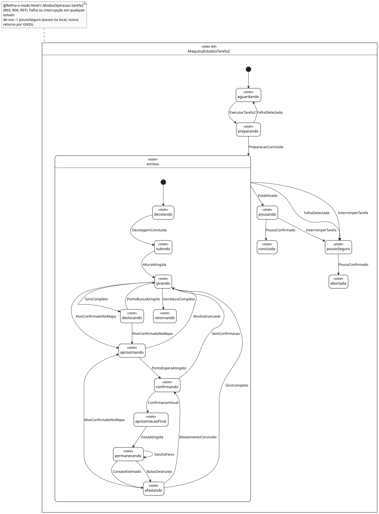
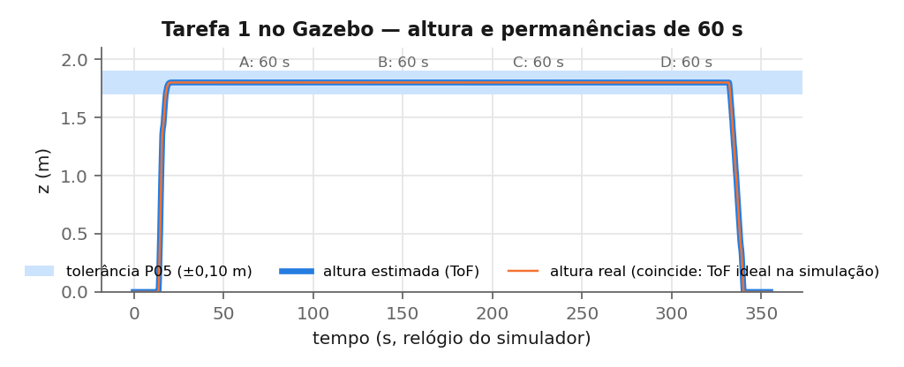
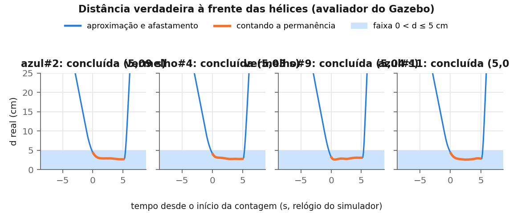
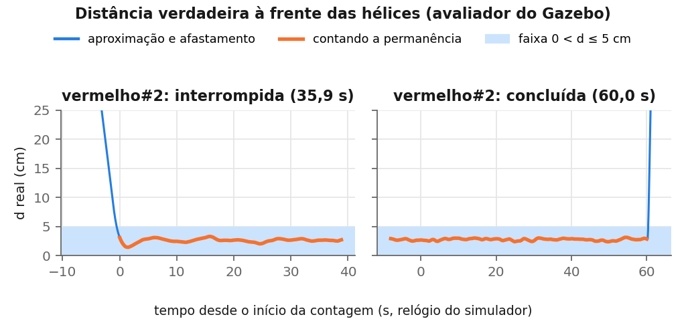
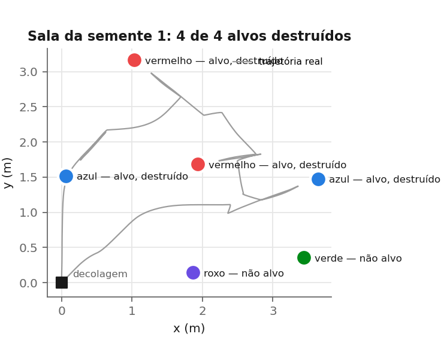
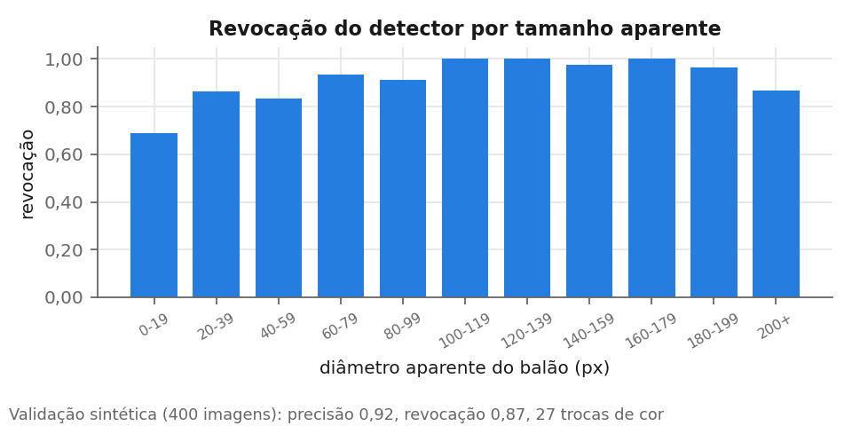

# PSI3442 — Segunda Prova — Relatório final

**Missões autônomas com o DJI Mini 4 Pro: voo de familiarização (Questão 1) e "risco baloeiro" (Questão 2)**

Equipe: **Caetano Maciel Anibali — nº USP 13681130** · Entrega final: 04/12/2026 · Enunciado v2.5 (15/11/2026)
Repositório: <https://github.com/Caetano-ma/PSI-3442> (instalação e execução no `README.md`)

---

## 1. Resumo e situação

O drone é um produto comercial fechado. O problema foi tratado como **software**: o alvo da decomposição são as
**missões**, e drone e rádio são caixas-pretas exploradas só pelo DJI Mobile SDK v5. O sistema tem três partes:
- um notebook Linux com **ROS 2 Jazzy**, que executa toda a lógica (Python);
- um celular Android com um **app ponte** em Kotlin (MSDK 5.20.1), ligado por USB ao controle RC-N2/N3;
- o Mini 4 Pro.

O operador só envia `executar tarefa 1`, `executar tarefa 2` ou `interromper`.

| Item | Testes sem voo | Simulação (Gazebo Harmonic) | Voo real |
|---|---|---|---|
| Tarefa 1 (P01–P06) | 105 testes pytest + 22 JVM, todos passando | concluída: 4 × 60 s no relógio do simulador (seção 7.1) | **pendente** |
| Tarefa 2 (R01–R09) | malha fechada sintética: alvos, deriva, balão em movimento, falhas | concluída com distância **verdadeira** em 0 < d ≤ 5 cm (seção 7.2) | **pendente** |
| Adaptador DJI | compila contra o MSDK 5.20.1 (APIs conferidas no jar) | — | APIs de voo, câmera, obstáculos e gimbal ainda **não exercitadas com a aeronave** |

**O voo real ainda não foi feito.** Ele depende do controle RC-N2/RC-N3 do kit (hipótese H7) e da App Key da DJI
para o pacote `br.usp.psi3442.ponte`. Todos os resultados numéricos deste relatório são de **simulação** ou de
**testes sem voo**, identificados como tal. O roteiro de voo (T00–T04 e os ensaios da Tarefa 2) está pronto em
`ensaios/roteiro_voo_tarefa1.md`.

## 2. Método: sistêmico e espiral

Cada ciclo começou pelo maior risco aberto e terminou com o modelo SysML e a matriz de rastreabilidade revalidados
(`executar_modelo.py` e `gerar_matriz.py`, que sai com erro se algum requisito ficar sem função, módulo, arquivo ou
teste).

| Ciclo | Resultado | Risco tratado / revisão |
|---|---|---|
| C0 | Requisitos, níveis 0 e 1, critérios P05 (entrega de 27/11) | Escopo e aceitação |
| C1 | Viabilidade da ponte | O MSDK fala com o controle em **modo acessório USB** (o controle é o hospedeiro). Um emulador no notebook não consegue: a ponte de voo passou para um **celular** (revisão da arquitetura; modelo e diagramas atualizados) |
| C2 | Nós ROS 2 da Tarefa 1, simulador cinemático, Gazebo | Lógica e falhas sem arriscar o equipamento |
| C3 | App ponte Kotlin (variantes emulador e celular), testes JVM, Tarefa 1 de ponta a ponta com o app no emulador | Protocolo, watchdog, perda da ponte |
| C5 | Tarefa 2: visão (YOLOv8n), mapa, planejamento, medida de distância, canal de vídeo, Gazebo com câmera | R02–R06 |
| C4 | Voos T00–T04 e demonstração | **pendente** (H7) |

## 3. Requisitos e hipóteses

Os requisitos P01–P06 e R01–R09 estão no modelo (`00_Comum.sysml`) com os critérios de P05 aprovados:
- ±0,10 m na vertical e ±0,30 m na horizontal;
- 0,15 m/s para caracterizar "pairado";
- 0,50 m/s no toque.

Hipóteses principais:
- **H1** piso texturizado;
- **H2** ar parado;
- **H5** a deriva da posição integrada é o maior risco;
- **H7** controle compatível no kit;
- **H11** balões estáticos ou quase.

Hipóteses da Tarefa 2:
- balões de ~26 cm de diâmetro (raio horizontal 0,13 m, a confirmar com os balões da prova);
- balões da mesma cor a mais de 0,6 m entre centros;
- câmera nivelada (gimbal em 0°);
- cores-alvo e volume permitido declarados em `config/tarefas.yaml` (R01).

Margens do R06, definidas antes dos testes:
- **0,40 m** de paredes e móveis;
- **0,50 m** de balões não alvo, entre superfícies;
- distintas da faixa de aproximação do alvo (0 < d ≤ 5 cm, alvo de 2,5 cm).

## 4. Arquitetura e modelo SysML 2.0

O modelo está em `modelo_sysml/` e é editável e executável no kernel SysML v2 Pilot 0.63.1 (JupyterLab). Ele tem
cinco pacotes e 18 vistas exportadas em `vistas/`:

| Nível | Conteúdo |
|---|---|
| **Nível 0** | Contexto: operador, ambiente físico, drone, rádio, celular, notebook; o simulador como ambiente de teste. Função global, cenário de operação, fronteiras e requisitos |
| **Nível 1** | Decomposição funcional em interpretar comando, gerenciar tarefas, executar tarefa 1/2, estimar estado, perceber alvos, mapear, controlar voo, supervisionar, registrar, traduzir para DJI, acionar SDK. Alocação a nós ROS 2 e ao app ponte; tópicos tipados; modos de operação |
| **Nível n** | Módulos (classe/arquivo) com algoritmo, unidades, taxas, contratos de interface e tratamento de erros; máquinas de estados das duas tarefas; ciclo de controle (10 Hz); malha imagem → percepção → decisão → comando |

A decomposição para quando cada folha:
- é um único arquivo ou classe;
- tem entradas e saídas tipadas, com unidades e referencial;
- é verificável isoladamente.

**Reuso entre os projetos** (exigência da seção 4), sem modificação entre as tarefas:
- estimação de estado;
- controle de posição;
- supervisão e segurança (incluindo a tabela de falhas);
- registro;
- ponte DJI;
- gerenciador de tarefas;
- `CronometroPermanencia`, a mesma classe nas duas tarefas.

A Tarefa 2 acrescenta três nós (visão, mapa, tarefa 2), o canal de vídeo e a guinada no controle.

**Do modelo ao código.** Cada módulo do nível n tem o atributo `arquivoCodigo` e cada caso de verificação tem o
atributo `arquivoTeste`. O `gerar_matriz.py` monta as matrizes requisito → função → componente → módulo → arquivo →
teste/evidência (`rastreabilidade/matriz_q1.md` e `matriz_q2.md`) e falha se faltar algum elo. Toda mudança de
implementação foi refletida no modelo, que é revalidado no kernel. Não há gerador automático de código a partir do
SysML: a consistência é conferida pelos testes e por essa checagem.

## 5. Implementação

### 5.1 Comum às duas tarefas

**Referencial local.** Origem no ponto de decolagem (A), x para B, y para D, z para cima.
- A guinada ψ₀ do nariz na decolagem converte as velocidades norte/leste da DJI: x = N cos ψ₀ + E sin ψ₀.
- **Posição**: integração trapezoidal das velocidades do posicionamento visual.
- **Altura**: sensor ToF.
- Sem GNSS (R07): nenhum retorno automático por satélite; toda falha em voo pousa no local.

**Controle de posição.** Proporcional saturado por eixo, com kp = 0,8 s⁻¹ e |v| ≤ 0,3 m/s, mais guinada
(1,5 s⁻¹, ≤ 30 °/s). O comando vai ao controle virtual da DJI em **velocidade no referencial do solo**: a
estabilização fica no firmware (caixa-preta).

**Supervisão.** Detecta 9 tipos de falha; o término seguro é pousar no local.
- perda de enlace;
- perda da ponte (sem heartbeat por 2 s, o app pousa);
- telemetria atrasada;
- bateria crítica (15 %);
- estimativa inválida;
- posicionamento visual inativo;
- desvio excessivo (fora do quadrado ou do volume da Tarefa 2);
- tempo excedido;
- comando rejeitado pelo SDK.

**Registro.** rosbag2 de todos os tópicos e exportação para CSV de evidência (`exportar_csv.py`). O
`analisar_ensaio.py` calcula as métricas da seção 7.

### 5.2 Tarefa 2

**Varredura.** Grade de pontos de busca em serpentina dentro do volume. Em cada ponto, o drone gira 360° em passos
de 45° e pausa 1,5 s em cada direção.

**Percepção (R02).** YOLOv8 nano com 5 classes (uma por cor), entrada de 416 px, executado no notebook pelo
**ONNX Runtime**. O `cv2.dnn` 4.6 do Ubuntu 24.04 não aceita a cabeça do YOLOv8.
- **Treino:** só com imagens **sintéticas** por randomização de domínio: fundo de sala, móveis, distratores nas
  cores dos balões, oclusões, cortes, desfoque, ruído, JPEG e balanço de branco (seção 7.3).
- **Direção:** vem do centro da caixa, pelo modelo pinhole.
- **Distância de longe:** vem da largura aparente (D = r / sen(atan(r_px/f))).
- **De perto**, o balão não cabe na caixa, e entra a **medida de proximidade** (seção 6).
- **Campo de visão:** o horizontal está na configuração (82,1°, *a verificar no fluxo ao vivo*). A resolução é a do
  quadro recebido.
- **Iluminação:** é tratada pela randomização e pela confirmação por cor central (HSV).
- **Oclusão:** caixas cortadas pela borda ou ocluídas não entram no mapa.

**Mapa local.** Cada detecção vira um ponto, calculado a partir da pose estimada.
- **Associação:** por cor, com janela de max(0,45 m; 3σ; 0,25·D).
- **Fusão:** média ponderada por 1/D².
- **Ciclo de vida:** CANDIDATO → CONFIRMADO (3 observações) → DESTRUÍDO.
- **Duplicatas:** balões da mesma cor a menos de 0,6 m são fundidos, e uma fusão com um destruído continua
  destruída. Isso **impede contagem duplicada**.
- **Marcos:** balões com mais de 20 observações viram marcos, e o resíduo de detecções de perto realinha o mapa
  inteiro, compensando a deriva.
- **Obstáculos:** grade de ocupação 2D de 0,2 m alimentada pelas distâncias da percepção de obstáculos.

**Planejamento (R06).** Menor rota num **grafo de visibilidade** (Dijkstra), com nós em volta de cada balão
mapeado. Ela é replanejada quando um balão novo bloqueia o caminho. O ponto de aproximação é escolhido entre 8
direções livres de obstáculos e de outros balões.

**Sequência por alvo.**
1. **Ponto de espera**, a 0,60 m da superfície.
2. **Confirmação visual**, com o centro refinado pela média das detecções de perto.
3. **Rampa a 8 cm/s** até d = 2,5 cm.
4. **Permanência**, com o cronômetro reutilizado da Tarefa 1.
5. **Afastamento** e escolha do próximo alvo.

Após 60 s contínuos, o evento `BALAO_DESTRUIDO` leva a identificação e a cor, aparece no painel e nos logs, e o
balão é ignorado daí em diante.

### 5.3 Adaptador DJI (app ponte) e protocolo

Correspondência entre as interfaces da aplicação e as APIs do MSDK 5.20.1. Os nomes foram conferidos no jar
`dji-sdk-v5-aircraft-provided-5.20.1`, e o código compila contra ele.

| Interface (`Drone`) | API oficial |
|---|---|
| telemetria | `KeyManager.listen`: `FlightControllerKey.KeyAircraftVelocity`, `KeyAltitude`, `KeyUltrasonicHeight`, `KeyAircraftAttitude`, `KeyIsFlying`, `KeyAreMotorsOn`, `KeyFlightMode`, `KeyConnection`, `KeyFailsafeAction`; `BatteryKey.KeyChargeRemainingInPercent`; `FlightAssistantKey.KeyVisionPositioningEnabled` |
| decolar / pousar | `KeyManager.performAction(KeyStartTakeoff / KeyStartAutoLanding)` |
| controle virtual | `VirtualStickManager.enableVirtualStick`, `setVirtualStickAdvancedModeEnabled`, `sendVirtualStickAdvancedParam` (velocidade, referencial do solo, taxa de guinada) |
| perda de sinal → pousar | `setValue(FlightControllerKey.KeyFailsafeAction, FailsafeAction.LANDING)` |
| quadros da câmera | `MediaDataCenter.getInstance().cameraStreamManager.addFrameListener(LEFT_OR_MAIN, FrameFormat.NV21, …)` → redução para ~640 px → JPEG |
| obstáculos | `PerceptionManager.getInstance().addObstacleDataListener` → `ObstacleData.horizontalObstacleDistance` (mm), `horizontalAngleInterval` |
| câmera nivelada | `KeyManager.performAction(GimbalKey.KeyRotateByAngle, GimbalAngleRotation(ABSOLUTE_ANGLE, pitch 0°))` |

**Protocolo ROS 2 ↔ app.** TCP, com o celular como servidor, pelo Wi-Fi.
- **Porta 5760:** JSON por linha, com telemetria (10 Hz), `cmd_vel` (20 Hz), ações, heartbeat (1 Hz), erros e
  obstáculos (5 Hz).
- **Porta 5761:** vídeo, com cabeçalho JSON + JPEG a 5 Hz. Só o quadro mais recente é enviado, e os atrasados são
  descartados.

**Latência e perda de comunicação.**
- O app zera a velocidade se ficar 0,2 s sem `cmd_vel` (watchdog).
- Sem heartbeat por 2 s, o app comanda o pouso.
- Se o enlace com a aeronave cair, a ação configurada é "pousar".
- A latência da cadeia (estimada ≤ 300 ms, H9) entra no controle como atraso. Por isso as velocidades são baixas
  (≤ 0,3 m/s; 8 cm/s na aproximação final).

**Variante falsa.** O `DroneFalso` é cinemático e tem uma câmera sintética por traçado de raios. Ele permite testar
o app inteiro no emulador ou no celular sem a aeronave.

**Ainda não exercitado com o drone real:**
- unidade e sentido do `ObstacleData`;
- resolução e campo de visão do fluxo;
- eixo roll/pitch do controle virtual (ensaio T00);
- desempenho do controle.

### 5.4 Simulação

O simulador é o **Gazebo Harmonic** (gz-sim 8.10) com ros_gz, renderização ogre2 e operação sem janela. Ele foi
instalado sem sudo via RoboStack.
- **Drone:** caixa-preta com as dimensões do Mini 4 Pro desdobrado (0,298 × 0,373 × 0,101 m, *a verificar*), sem
  gravidade (o firmware sustenta) e com VelocityControl.
- **App ponte simulado:** usa o mesmo protocolo e aplica resposta de 1ª ordem (τ = 0,3 s), ruído e viés opcional
  nas velocidades medidas.
- **Câmera:** 640 × 480 com o campo de visão da configuração.
- **Distâncias:** um lidar 2D de 120 raios no lugar da percepção DJI.
- **Sala da Tarefa 2:** gerada a partir de uma **semente**. Ela define posições e cores dos balões (alvos garantidos),
  paredes e móveis. A verdade fica em `verdade.yaml`.
- **Avaliador:** só ele lê a verdade (R05) e grava a distância real d (frente das hélices → superfície do balão-alvo).
- **Relógio:** toda a lógica usa o **relógio do simulador** (`use_sim_time`), como pede o R04.

Simplificações:
- balões rígidos e estáticos;
- sem efeito do vento das hélices sobre o balão;
- iluminação idealizada;
- posição medida pela odometria do simulador derivada no tempo, e não por fluxo óptico.

## 6. Medição da distância e incerteza (R04, R05)

**Geometria.** d é a distância entre a superfície do balão e o envelope frontal com hélices. Ela é estimada como
d = |c − p_frente| − r, com:
- p_frente: pose estimada + 0,149 m na direção do nariz (*a verificar no manual*);
- c: centro do balão **medido pela câmera**;
- r = 0,13 m.

**Medida de proximidade.** A 2–5 cm do envelope, a câmera, que fica 0,10 m à frente do centro, está a ~0,20 m do
centro do balão.
- Ele ocupa ~600 px dos 640 da largura, mas as duas bordas laterais ainda aparecem até d ≈ 1,9 cm.
- Entre as linhas que cruzam a coluna central, a **mais larga** passa pelo centro do balão. A meia-largura angular α
  dá D = r / sen α, as bordas dão o azimute e a linha dá a elevação. Isso fixa c em 3D a cada quadro (5 Hz).
- Se o balão toca a borda, a corda vista é menor que o diâmetro e D é só um **limite superior**. Ele só corrige o
  lado que garante e só conta para a permanência se garantir d ≤ 5 cm.
- O ponto final e o de espera são **reancorados** em c, com filtro de 0,5 por quadro. Assim, a permanência segue o
  balão e não a posição integrada, cuja deriva é o maior risco (H5).
- Isso também atende "manter a posição relativa caso a bexiga se movimente". O teste com o balão andando a 1 cm/s
  passa.

**Incerteza da estimativa.** Ela é dominada por quatro fontes:

| Fonte | Efeito |
|---|---|
| Bordas (±0,5 px, ~0,4 mm/px a 0,2 m) | ±0,2 mm |
| Raio do balão (±5 mm, se não medido) | ±5 mm em D, o que desloca d diretamente; **medir os balões da prova** |
| Campo de visão (±2°) | ±3 mm |
| Envelope frontal (±5 mm) | ±5 mm |

Combinadas, dão **±8 mm (1σ)**. Por isso o alvo é d = 2,5 cm, no meio da faixa. Na simulação, o erro de estimação
observado durante a contagem ficou abaixo de 1,5 cm (seção 7).

**Validação, sem acesso do algoritmo.**
- **Na simulação:** o avaliador calcula d real pela verdade do Gazebo a 10 Hz (relógio do simulador) e o grava em
  `avaliacao.csv`.
- **No voo real:** uma câmera lateral fixa (celular, 30 quadros/s), perpendicular ao eixo de aproximação e com uma
  régua milimetrada no plano do balão. A folga é medida quadro a quadro, com incerteza de ~2 mm a 1 m de distância.
  A taxa de 30 Hz é 6× a taxa de controle da permanência e resolve movimentos de 0,08 m/s a cada ~3 mm.

## 7. Verificação e resultados

Os critérios de aprovação foram declarados antes dos ensaios: P05 para a Tarefa 1; R04 e as margens do R06 para a
Tarefa 2. **Todos os resultados abaixo são de simulação ou de testes sem voo.** Os resultados de voo real serão
acrescentados após os ensaios T00–T04 e S1–S4 (`ensaios/roteiro_voo_tarefa1.md`). Os dados de cada ensaio estão em
`ensaios/simulacao/<ensaio>/`: CSV de evidência, eventos, métricas, verdade e avaliação.

### 7.1 Tarefa 1 — Gazebo, 60 s por vértice (relógio do simulador)

| Critério (P05) | Limite | Resultado |
|---|---|---|
| Altura nas permanências e deslocamentos | ±0,10 m | erro máx. 0,076 m (RMS 0,003 m) |
| Trajetória (distância ao quadrado) | ±0,30 m | máx. 0,005 m (estimado); erro da estimativa contra a verdade: máx. 0,137 m |
| Permanências contínuas | 4 × 60 s | A 60,0 s · B 60,0 s · C 60,0 s · D 60,0 s, 0 reinícios |
| Pairado durante a contagem | ≤ 0,15 m/s | máx. 0,131 m/s |
| Fechamento do quadrado (toque × decolagem) | ≤ 0,30 m | 0,002 m (estimado), **0,057 m (real)** |
| Velocidade vertical no toque | ≤ 0,50 m/s | 0,40 m/s |
| Duração / falhas | — | 327 s; nenhuma falha |

O reinício da contagem é verificado pelo teste T05 (sequência sintética de vereditos) e aparece em simulação na
Tarefa 2 (alvo único, 7.2), que usa o mesmo cronômetro. A Tarefa 1 também foi executada de ponta a ponta com o app
ponte real no **emulador Android** (drone falso, `simulacoes/emulador_*`): concluída, com telemetria a 10 Hz e erro
vertical máx. de 0,069 m.

### 7.2 Tarefa 2 — Gazebo (relógio do simulador; distância real pelo avaliador)

| Cenário (seção 7) | Sala | Alvos destruídos | d real durante as contagens | Erro de estimação de d na contagem | Menor folga a não alvo | Colisões |
|---|---|---|---|---|---|---|
| Um único alvo, cores não alvo, **60 s** | semente 3 (1 alvo, 2 não alvo) | 1/1 (1 reinício aos 35,9 s; depois 60,0 s contínuos) | 1,4 – 3,3 cm | — (antes da gravação de d estimada) | 0,36 m ⚠ | 0 |
| Múltiplos alvos e cores não alvo | semente 1 (4 alvos, 2 não alvo) | **4/4**, cada um uma vez | 2,6 – 4,3 cm | mediana 0,3 cm, máx. 0,8 cm | 0,79 m | 0 |
| Múltiplos alvos, sala densa | semente 2 (6 alvos, 1 não alvo) | <!-- S2 --> | <!-- S2D --> | <!-- S2E --> | <!-- S2F --> | <!-- S2C --> |

O centro de cada balão destruído ficou a 1,2–7 cm do real. A identificação no evento e no painel corresponde
sempre à cor real.

Na sala da semente 3, a folga de 0,36 m a um não alvo foi medida antes da correção da margem lateral (seção 9). A
regra passou a usar a meia-diagonal do envelope, e as salas 1 e 2, rodadas depois da correção, ficaram acima de
0,5 m.

### 7.3 Testes sem voo (malha fechada sintética e unitários)

São **110 testes pytest** (lógica das duas tarefas e serviços comuns), **7 testes** do pacote Gazebo e **22 testes
JVM** do app ponte, todos passando. Com o ROS 2 do sistema, o `colcon test` deu 114 testes sem falha. Os cenários da
seção 7 que não cabem no Gazebo ou não devem ser feitos em voo:

| Cenário | Teste | Resultado |
|---|---|---|
| Ausência de alvos | `test_sem_alvos_varre_e_pousa` | varre a sala, pousa, nenhuma seleção |
| Perda de detecção na permanência (3 s) | `test_perda_de_deteccao_na_permanencia_reinicia` | interrompe, reinicia, conclui |
| Reinício após sair da faixa (rajada) | `test_reinicia_contagem_ao_sair_da_faixa` | interrupção registrada após > 2 s; nova contagem completa |
| Alvo junto de obstáculo | `test_alvo_perto_de_obstaculo_aproxima_pelo_lado_livre` | aproxima pelo lado livre |
| Tempo de missão excedido | `test_tempo_de_missao_excedido_pousa_no_local` | falha `tempoTarefaExcedido`, pouso no local |
| Interrupção pelo operador | `test_interromper_pousa_no_local` | pouso no local, tarefa abortada |
| Deriva da posição 0,5 / 2 cm/s, 60 s | `test_permanencia_de_60s_com_deriva_da_posicao`, `test_deriva_extrema_…` | d real sempre em 0 < d ≤ 5 cm |
| Balão em movimento (1 cm/s) | `test_balao_em_movimento_mantem_a_faixa` | segue > 25 cm, sempre na faixa |
| Erro de 10 % no tamanho aparente | `test_sala_aleatoria_com_erro_de_tamanho_…` | 6/6 alvos, cada um uma vez |
| Fantasma junto de balão destruído | `test_fantasma_perto_de_balao_destruido_…` | descartado, sem recontagem |
| Perda da ponte e watchdog | T07/T09 (Tarefa 1, reutilizados) | velocidade zero em 0,2 s; pouso após 2 s |

### 7.4 Percepção

O detector foi avaliado nas 400 imagens sintéticas de validação, com o mesmo código do voo
(`modelos/metricas_detector.json`):
- **precisão 0,92** e **revocação 0,87**;
- revocação ≥ 0,91 para diâmetro aparente ≥ 60 px e 0,69 abaixo de 20 px (balões a mais de ~5 m);
- 27 trocas de cor em 936 balões (2,9 %).

No Gazebo, todas as destruições foram da cor certa. A confirmação de perto (cor central em HSV) e a fusão de
observações no mapa filtram trocas isoladas.

## 8. Justificativa técnico-econômica

*(até duas páginas)*

**Restrições do problema.** O drone é dado e é fechado: não há acesso ao controlador de voo nem a sensores
crus. O único caminho oficial de integração com o Mini 4 Pro é o **DJI Mobile SDK v5 para Android**, que exige:
- um controle **RC-N2/RC-N3**;
- um dispositivo Android ligado a ele por USB.

O MSDK não roda em notebook, e o Mini 4 Pro não é suportado pelos SDKs Windows/Onboard/Payload. As alternativas
foram avaliadas assim:

| Alternativa | Custo de aquisição | Custo de desenvolvimento | Risco técnico | Decisão |
|---|---|---|---|---|
| A. Missão inteira no app Android (Kotlin) | só o celular | alto: visão, mapa, planejamento e testes em Kotlin; ciclo lento (APK a cada mudança); sem rosbag | bateria e CPU do celular; depuração difícil | descartada |
| B. **Notebook com ROS 2 + celular como ponte fina** | notebook e celular da equipe | médio: lógica em Python testável sem hardware; ecossistema ROS (rosbag2, Gazebo, ros_gz) | latência do Wi-Fi (mitigada: velocidades baixas, watchdog e pouso por perda da ponte) | **escolhida** |
| C. Emulador Android no notebook como ponte | nenhum | baixo | **inviável**: o MSDK usa o modo acessório USB (o controle é o hospedeiro) | só para testes, com drone falso |
| D. Trocar por um drone aberto (PX4/ArduPilot) | outro equipamento | baixo | fora do enunciado (o drone é dado) | não aplicável |

**Custos.** Todo o software usado é gratuito:
- ROS 2 (Apache 2.0), Gazebo (Apache 2.0), OpenCV (Apache 2.0) e ONNX Runtime (MIT);
- o kernel SysML v2 Pilot (EPL/LGPL);
- o MSDK da DJI, cujo registro de desenvolvedor é gratuito.

A atenção econômica e jurídica está no **ultralytics/YOLOv8**, licenciado sob **AGPL-3.0**:
- o uso acadêmico com código aberto é compatível;
- um produto comercial fechado exigiria licença paga da Ultralytics ou outro detector (por exemplo, um YOLO de
  licença permissiva, ou só segmentação por cor, que nos testes já basta de perto).

**Hardware e operação.**
- O notebook Linux comum da equipe basta: inferência em CPU de 30–200 ms por quadro, a 5 Hz; treino em CPU de
  ~20 min por época, sem GPU.
- O único item possivelmente a adquirir é o controle compatível: o DJI RC 2 de algumas versões do kit não é suportado
  pelo MSDK.
- O custo de operação é o tempo de bateria. A Tarefa 1 dura ~6 min; a Tarefa 2 cabe numa bateria só com poucos
  balões (60 s cada + varredura). Por isso o limite de 15 % pousa no local.

**Custo do desenvolvimento e da validação.** A escolha que mais reduziu custo e risco foi testar quase tudo **sem
voo**, em três camadas:
1. malha fechada sintética em Python: segundos por missão, 105 testes;
2. Gazebo com câmera e verdade de referência: minutos por missão;
3. app no emulador ou no celular com drone falso.

Assim, as horas de voo ficam reservadas para o que só o voo mostra: a deriva real, o eixo do controle virtual e a
latência. Isso reduz o risco de dano ao equipamento, que é o maior custo potencial do projeto, e o tempo de
laboratório. A IA generativa reduziu o tempo de escrita de código e documentação, mas acrescentou custo de revisão:
cada artefato foi verificado por testes automáticos e por validação no simulador (seção 10).

**Por que a medida pela câmera.** O requisito dos 5 cm pede precisão de milímetros. A especificação de pairado da DJI
com posicionamento visual é de ±0,3 m na horizontal, e a posição integrada deriva. Um sensor dedicado (ToF frontal ou
lidar) não é possível: o drone é fechado. A câmera, que já está a bordo, dá a distância relativa ao balão com
incerteza estimada de ~8 mm, sem custo adicional. É a única solução de custo zero coerente com o "drone caixa-preta".

**Escalabilidade.** Trocar a aeronave por outra suportada pelo MSDK muda só o `DroneDji` e os parâmetros (envelope,
campo de visão). A missão, a simulação e os testes não mudam.

## 9. Limitações e riscos

- **Sem voo real até esta versão** (H7: controle RC-N2/N3 e App Key). Ainda sem validação com o drone:
  - a precisão real do controle virtual a 5 cm;
  - a deriva real do posicionamento visual;
  - a latência real da cadeia;
  - a unidade e o sentido do `ObstacleData`;
  - o campo de visão e a resolução do fluxo ao vivo;
  - o eixo roll/pitch (T00).
- **Distância pelo tamanho:** depende do raio do balão. Balões reais não são esferas exatas, e o raio deve ser
  medido. De longe, o erro é de ~15 %, o que gera duplicatas no mapa (tratadas pela fusão a 0,6 m).
- **Detector treinado só com imagens sintéticas.** Ainda não avaliado com imagens reais; o desempenho cai abaixo de
  ~20 px de diâmetro. Recomenda-se ajuste fino com quadros reais da sala antes da demonstração.
- **Fluxo de ar das hélices a 2,5 cm pode empurrar o balão.** A reancoragem segue o balão (testado a 1 cm/s), mas
  movimentos rápidos interrompem a contagem (reinício correto, porém mais tempo).
- **Deriva da posição integrada:** com 2 cm/s simulado, a missão ainda conclui; deriva maior acumula erro no mapa
  de longe.
- **Simulação:** a dinâmica é de 1ª ordem; não há efeito aerodinâmico, iluminação real nem fluxo óptico. O lidar 2D
  substitui a percepção 360° da DJI, que no Mini 4 Pro pode ter alcance e cobertura diferentes.
- **Envelope frontal de 0,149 m e campo de visão de 82,1°:** valores a verificar. Um erro de 1 cm no envelope é
  1 cm em d.
- **Margens do R06:** a primeira versão media a folga lateral pelo raio frontal do envelope (0,149 m). Na sala da
  semente 3, isso deixou 0,36 m até um não alvo. A regra foi corrigida para a meia-diagonal do envelope com hélices
  (0,239 m), entre superfícies:
  - 0,50 m a cores não alvo;
  - 0,30 m a outros balões de cor-alvo;
  - 0,15 m a candidatos ainda não confirmados (podem ser falsos).
- **Fantasmas no mapa:** a distância de longe pelo tamanho aparente erra ~15 % e gera entradas falsas. Contra elas
  há quatro salvaguardas, todas exercitadas no Gazebo:
  - confirmação de perto;
  - descarte de entradas coladas a balões destruídos;
  - fusão de duplicatas;
  - contagem só com medida de perto que concorda com o alvo (a até 0,10 m do centro).
  A última foi acrescentada depois que um ensaio da semente 2 contou um fantasma vendo de perto o balão vermelho
  real ao lado. Os ensaios das sementes 1 e 3 são anteriores a essa correção, que só torna a contagem mais
  restritiva; em ambos, todas as destruições tiveram centro a ≤ 7 cm do balão real.
- **Não alvos fora do plano do sensor de distâncias:** um balão acima ou abaixo do plano da percepção de obstáculos
  só é evitado se estiver no mapa pela câmera. Num ensaio da semente 2, o drone passou a 6,5 cm de um balão verde a
  caminho de um ponto de busca. Mitigação prevista: margem maior a candidatos e varredura com câmera antes de cada
  deslocamento.
- **Sala densa:** em salas com muitos alvos a ~1 m uns dos outros e perto das paredes, alguns podem ficar
  inalcançáveis com essas margens. A missão termina com segurança e os registra; reduzir margens é decisão a tomar
  antes do ensaio, nunca depois.

## 10. Uso de inteligência artificial

| Item | Registro |
|---|---|
| Ferramenta | **Claude Code** (Anthropic), extensão para VS Code, em notebook Windows (até 24/11) e Linux Mint (a partir de 27/11) |
| Modelos | Claude Sonnet 5 e **Claude Opus 5.5** (`claude-opus-5-5`) |
| Período | 16/11/2026 a 04/12/2026 |
| Artefatos gerados com IA | modelo SysML (5 pacotes) e scripts de validação/matriz; diagramas; nós ROS 2 e testes; app ponte Kotlin e testes; mundo e avaliador do Gazebo; gerador de dados sintéticos e treino do YOLO; ferramentas de análise; README, roteiros, este relatório e a apresentação |

**Prompts relevantes (resumidos, da equipe):**
1. ler o enunciado e começar a Questão 1;
2. avaliar os diagramas da P1 e parar se houvesse erro;
3. criar o nível n e o SysML executável;
4. trocar o paradigma para notebook com ROS 2 e Android como ponte;
5. operar só por "executar tarefa 1/2";
6. terminar a entrega de 27/11;
7. migrar para o Linux e fechar a Tarefa 1 no drone físico;
8. explicar por que o emulador não substitui o celular;
9. criar a sala da Tarefa 2 com balões aleatórios, mapear e ignorar balões já destruídos, com um modelo de visão
   (a equipe escolheu: seguir o R04, YOLO treinado e Gazebo);
10. garantir as duas tarefas no Gazebo e no drone real e preparar relatório e slides.

**Correções feitas pela equipe sobre o que a IA propôs:**
- diagramas redesenhados do zero foram rejeitados (adaptar os da P1);
- a arquitetura foi trocada para notebook com ROS 2;
- a pilotagem pelo controle remoto foi removida;
- a ponte passou para o celular (USB acessório).

**Erros da IA encontrados nos testes e na simulação, e corrigidos:**

| Erro | Correção |
|---|---|
| Permanência que encostava no balão por usar o centro do mapa (malha sintética) | Medida de proximidade pela câmera |
| Rota que passava a 0,27 m de um balão não alvo | Grafo de visibilidade com replanejamento |
| Drone 14 cm abaixo do balão (Gazebo) | Linha mais larga dá a elevação |
| Cronômetro no relógio de parede na simulação, contra o R04 | `use_sim_time` |
| Duplicatas no mapa bloqueando o próprio alvo | Fusão a 0,6 m |
| `cv2.dnn` 4.6 incompatível com o ONNX do YOLOv8 | ONNX Runtime |
| Processos de um ensaio anterior contaminando o seguinte | Limpeza antes de cada ensaio |

Nomes de API foram **conferidos no jar do SDK** em vez de aceitos de memória. A responsabilidade pela consistência,
pelo código, pelas referências e pela validação permanece com a equipe.

## 11. Reprodutibilidade

- `README.md` traz:
  - instalação com os scripts de `ambiente/` (ROS 2 do sistema; Gazebo sem sudo via RoboStack; venv do YOLO; conda
    do SysML);
  - versões fixadas;
  - comandos por terminal, na simulação e no voo real.
- **Sementes registradas:**
  - salas do Gazebo (`semente:=N`, gravada em `verdade.yaml`);
  - conjunto sintético (`--semente 1`);
  - ruído dos simuladores (`semente` dos parâmetros).
- **Parâmetros:** todos em `config/tarefas.yaml`, validados ao carregar (unidades, faixas e coerência dos
  vértices).
- **Resultados de simulação** em `ensaios/simulacao/<ensaio>/`:
  - CSV de evidência, eventos e métricas;
  - `verdade.csv` e `avaliacao.csv`;
  - `resumo.yaml` do avaliador.
  - Os bags completos ficam fora do repositório por tamanho e são regenerados pelos comandos do README.

## Referências

- Zuffo, M. K. *Segunda Prova — PSI3442 — Projeto de Sistemas Embarcados*, v2.5, 15/11/2026.
- DJI. *Mobile SDK v5* — documentação, notas de versão e produtos suportados (Mini 4 Pro com RC-N2/RC-N3, SDK ≥ 5.13). <https://developer.dji.com/doc/mobile-sdk-tutorial/en/index.html>; <https://github.com/dji-sdk/Mobile-SDK-Android-V5> (consultado em 27/11/2026).
- DJI. *DJI Mini 4 Pro — especificações* (pairado com posicionamento visual: ±0,1 m vertical, ±0,3 m horizontal). <https://www.dji.com/mini-4-pro/specs>.
- Macenski, S.; Foote, T.; Gerkey, B.; Lalancette, C.; Woodall, W. Robot Operating System 2: Design, architecture, and uses in the wild. *Science Robotics*, 7(66), 2022.
- Open Robotics. *ROS 2 Jazzy* e *Gazebo Harmonic* — documentação. <https://docs.ros.org/en/jazzy/>; <https://gazebosim.org/docs/harmonic>.
- Koenig, N.; Howard, A. Design and use paradigms for Gazebo, an open-source multi-robot simulator. *IEEE/RSJ IROS*, 2004.
- Redmon, J.; Divvala, S.; Girshick, R.; Farhadi, A. You Only Look Once: Unified, real-time object detection. *CVPR*, 2016.
- Jocher, G.; Chaurasia, A.; Qiu, J. *Ultralytics YOLOv8*, 2023 (AGPL-3.0). <https://github.com/ultralytics/ultralytics>.
- Tobin, J. et al. Domain randomization for transferring deep neural networks from simulation to the real world. *IEEE/RSJ IROS*, 2017.
- Hartley, R.; Zisserman, A. *Multiple View Geometry in Computer Vision*, 2. ed. Cambridge University Press, 2004 (modelo pinhole).
- Thrun, S.; Burgard, W.; Fox, D. *Probabilistic Robotics*. MIT Press, 2005 (grades de ocupação, fusão de observações).
- Lozano-Pérez, T.; Wesley, M. A. An algorithm for planning collision-free paths among polyhedral obstacles. *Communications of the ACM*, 22(10), 1979 (grafo de visibilidade); Dijkstra, E. W. A note on two problems in connexion with graphs. *Numerische Mathematik*, 1, 1959.
- Boehm, B. W. A spiral model of software development and enhancement. *IEEE Computer*, 21(5), 1988.
- INCOSE. *Systems Engineering Handbook*, 5. ed. Wiley, 2023.
- OMG. *OMG Systems Modeling Language (SysML) v2* e *SysML v2 Pilot Implementation 0.63.1*. <https://github.com/Systems-Modeling/SysML-v2-Release>; SysON: <https://mbse-syson.org/>.
- ONNX Runtime. <https://onnxruntime.ai/>.
